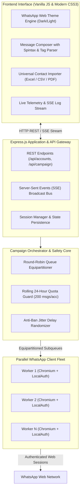

# 📢 WhatsApp Campaign Studio

<div align="center">


**Enterprise-Grade Multi-Account WhatsApp Marketing & Fleet Automation Dashboard**

[](https://nodejs.org/)
[](https://expressjs.com/)
[](https://pptr.dev/)
[](#-interactive-showcase-mode)
[](LICENSE)

*Engineered for high-throughput, ban-resilient bulk messaging with authentic WhatsApp Web aesthetics, real-time Server-Sent Events (SSE) telemetry, and intelligent parallel worker equipartitioning.*

</div>

---

## 🌟 Overview

**WhatsApp Campaign Studio** is a full-stack automation platform designed to empower teams with high-volume, reliable WhatsApp messaging campaigns. Built around multi-account fleet orchestration, the system balances outgoing message queues across multiple sender accounts concurrently, safeguards accounts with dynamic 24-hour rolling quota windows, and delivers dynamic personalized outreach via advanced Spintax and media attachment pipelines.

> **💡 Portfolio & Demonstration Notice:** This repository is published as an engineering portfolio showcase demonstrating full-stack architecture, asynchronous job queueing, real-time reactive UI streaming, and anti-ban rate limiting algorithms.

---

## 🚀 Interactive Showcase Mode (Zero-Config Demo)

Want to evaluate the user interface, campaign orchestration, and telemetry without connecting real WhatsApp accounts?

Launch the project in **Showcase / Simulation Mode**:

```bash
# 1. Install dependencies
npm install

# 2. Start the interactive demo simulation
npm run demo
# or: node server.js --demo

# 3. Open in your browser:
# http://localhost:3000
```

### What happens in Showcase Mode?
- ✨ **Pre-Seeded Fleet**: Automatically provisions 3 virtual worker accounts (*Marketing Fleet Alpha*, *Client Outreach Beta*, *VIP Broadcast Gamma*).
- ⚡ **Simulated Dispatch**: Test campaign launches with real-time progress bars, worker thread countdowns, dynamic Spintax resolution, and live SSE log streams without scanning QR codes or sending real messages.
- 🎨 **Full UI Access**: Explore recipient importing, message personalization, media attachment previews, and theme switching.

---

## 🏗️ Architecture & System Design



---

## ⚡ Key Features

### 1. 👥 Multi-Account Parallel Fleet Dispatch
- Concurrently manage and broadcast across unlimited WhatsApp accounts.
- Recipient queues are automatically equipartitioned (divided equally) across all eligible connected accounts for maximum throughput.

### 2. 🛡️ 24-Hour Rolling Quota Guard (Anti-Ban Engine)
- Enforces a strict 200 messages / 24-hour safety ceiling per account.
- Implements a **rolling 24-hour countdown window** calculated from each account's first message dispatch timestamp, automatically unlocking quota when the window elapses.

### 3. ✍️ Intelligent Message Composer & Spintax
- **Dynamic Spintax:** Uses `{Hi|Hello|Hey|Greetings}` syntax to randomize message variations for every recipient, dramatically reducing copy-paste pattern detection.
- **Personalization Tokens:** Seamlessly inject `{name}`, `{phone}`, and `{custom}` recipient attributes.
- **Call-to-Action Link Buttons:** Generates formatted call-out buttons using `{link: url | title}`.

### 4. 📎 Multi-Format Media Engine
- Broadcast high-definition images (JPG, PNG, WebP), PDF documents (`.pdf`), and videos (MP4, MKV, MOV, WebM).
- Real-time client-side media previews with dual transmission modes:
  - **Single Bubble:** Media sent with an embedded caption.
  - **Dual Bubble:** Media delivered first, followed by a separate formatted text bubble.

### 5. 📥 Universal Contact Importer
- Ingest contact sheets directly from Excel (`.xlsx`, `.xls`), CSV, TSV, PDF documents, or raw text.
- Automatic column matching for Name, Phone, and Custom fields.
- 1-click on-demand deduplication.

### 6. 📊 Real-Time SSE Telemetry & Console Logs
- Full Server-Sent Events (SSE) pipe delivering sub-second updates on worker states, countdown timers, success/failure metrics, and terminal execution logs.

### 7. 🔐 Permanent Session Persistence
- Built on `LocalAuth` session caching — authenticated accounts remain connected across server reboots and browser closures until explicitly logged out.

---

## 📁 Project Structure

```plaintext
whatsapp-campaign-studio/
├── public/                       # Frontend application & assets
│   ├── favicon.ico               # App favicon
│   ├── index.html                # Single-page dashboard (WhatsApp design system)
│   ├── logo.png                  # Application logo
│   ├── pdf.min.js                # PDF.js client library
│   ├── pdf.worker.min.js         # PDF.js web worker
│   └── xlsx.full.min.js          # SheetJS Excel parsing library
├── server.js                     # Express server, campaign orchestrator & API
├── package.json                  # Project manifest and dependencies
├── .env.example                  # Environment configuration template
├── .gitignore                    # Git rules (excludes session tokens & local data)
├── campaign_studio_icon.ico      # High-res desktop icon
├── Create-Desktop-Icon.bat       # 1-Click Windows shortcut generator
├── start.bat                     # Windows automated launcher script
├── DEPLOYMENT_GUIDE.md           # Production deployment & client handoff guide
├── HOW_TO_RUN.md                 # Local setup and usage instructions
├── LICENSE                       # Source-Available Portfolio & Evaluation License
└── README.md                     # Project documentation
```

---

## 🛠️ Tech Stack

- **Runtime & Backend:** Node.js (v18+), Express.js (v4 / v5)
- **Browser Automation:** Puppeteer (Headless Chromium)
- **WhatsApp Web Integration:** [whatsapp-web.js](https://github.com/wwebjs/whatsapp-web.js)
- **Real-Time Streaming:** Server-Sent Events (SSE)
- **Frontend:** Vanilla JavaScript (ES6+), Modern CSS3 Tokens (WhatsApp Web Design Palette)
- **Parsers & Utilities:** PDF.js, SheetJS (`xlsx`), `pdf-parse`, `qrcode`, `fluent-ffmpeg`, `mime`

---

## 💻 Getting Started

### Prerequisites
- [Node.js](https://nodejs.org/) v18.0.0 or higher
- Chromium / Google Chrome installed (for production WhatsApp Web sessions)

### Installation
```bash
# Clone the repository
git clone https://github.com/your-username/whatsapp-campaign-studio.git
cd whatsapp-campaign-studio

# Install dependencies
npm install

# Configure environment variables
cp .env.example .env
```

### Running the Application

#### Option A: Quickstart on Windows (1-Click)
Double-click `start.bat` in the project root. It will check your environment, install any missing packages, boot the server, and open `http://localhost:3000` in your default browser.

#### Option B: Terminal (Production Mode)
```bash
npm start
# Server listens on http://localhost:3000
```

#### Option C: Interactive Showcase Demo Mode
```bash
npm run demo
# Runs zero-config simulated campaign environment
```

---

## 🌐 Production Deployment

For continuous 24/7 cloud deployment on Ubuntu Linux (DigitalOcean, AWS, Hetzner) or Docker:

- Refer to the included [DEPLOYMENT_GUIDE.md](DEPLOYMENT_GUIDE.md) for full Nginx reverse proxy, SSL Certbot, PM2 process management, and Docker instructions.

---

## 🤝 Credits & Open-Source Acknowledgements

WhatsApp Campaign Studio builds upon and integrates several exceptional open-source libraries:

- **[whatsapp-web.js](https://github.com/wwebjs/whatsapp-web.js)** — Created by [Pedro Lopez](https://github.com/pedroslopez) and the [wwebjs community](https://wwebjs.dev/). A comprehensive Node.js library for interacting with WhatsApp Web via Puppeteer.
- **[Puppeteer](https://pptr.dev/)** — Maintained by the Google Chrome DevTools team.
- **[Express.js](https://expressjs.com/)** — Fast, unopinionated, minimalist web framework for Node.js by OpenJS Foundation.
- **[PDF.js](https://mozilla.github.io/pdf.js/)** — Document parser by the Mozilla Foundation.
- **[SheetJS / xlsx](https://sheetjs.com/)** — Spreadsheet data parser by SheetJS LLC.
- **[node-qrcode](https://github.com/soldair/node-qrcode)** — QR code generator by Ryan Day and contributors.

---

## 📄 License & Intellectual Property Notice

This project is released under the **Source-Available Portfolio & Evaluation License**.

- **Permitted:** You may view, clone, and run this code locally for personal evaluation, technical review, educational study, and portfolio assessment.
- **Restricted:** Commercial deployment, SaaS hosting, unauthorized redistribution, resale, or sublicensing without explicit written authorization from the author is strictly prohibited.

For commercial inquiries, licensing agreements, or custom enterprise solutions, please reach out to **K J Vishnu Sastha (TRINOVA)**.

---

<div align="center">
<sub>Crafted with precision by <b>K J Vishnu Sastha </b></sub>
</div>
